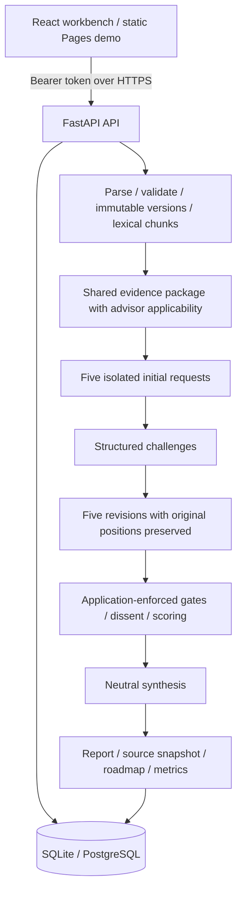

# Architecture

The application has three separate governance layers: organizational truth, advisor reasoning, and human decision authority. The proposed advisor mandates are configuration, not representations of actual directors.

## Frontend

React, TypeScript, Vite and Tailwind. Navigation includes overview, scenarios, advisors, source register, decision history and backend connection. Reports expose independent/revised perspectives, deliberation/dissent, evidence/risks and roadmap/metrics. Export downloads the complete structured report. History compares two reports side by side. Browser demo history is transient; connected API history persists.

The static demo is explicit deterministic simulation. It changes illustrative financial opposition and weights but does not semantically interpret arbitrary scenarios. `scripts/export_demo.py` packages only fixed repository-owned `public_demo` documents. It never reads uploaded documents or databases. Static demo and API orchestration are separate adapters, tested for key invariants.

## Backend

FastAPI uses Pydantic models for scenario, metadata, profiles and provider outputs. SQLAlchemy stores immutable document versions, chunk indexes, complete JSON decision snapshots and metadata-only audit entries. `create_all` is sufficient for the initial v0.1 schema; a migration tool is required before subsequent production schema changes.

`documents/` is divided into ingestion, parsing, validation, indexing and retrieval. Current retrieval is deterministic keyword overlap with advisor applicability and fallback passages; vector retrieval is an extension, not implemented semantic search. Markdown/text, PDF text extraction and DOCX paragraphs/tables are supported. No OCR, external links or embedded scripts execute.

`agents/` provides mock and OpenAI Responses adapters. Each initial call has only its own profile, scenario and evidence. Calls share no conversation history. Structured challenges are followed by five isolated revision requests. Synthesis sees all positions, dissent conditions and gates. Every citation must identify a supplied document version/chunk and reproduce an exact substring. Schema/citation errors stop execution; no partial report is saved.

## Configuration and boundaries

Five profiles are validated at startup. Profile versions and model identity are recorded per report. The charter is schema-validated at startup, supplied to provider requests and used for default scoring weights and report configuration identity. Mandatory gate definitions cannot be removed; operational enforcement remains in the gate engine. Organizational mission is retrieved from evidence, not hardcoded as authentic Foundation policy. A deployment serves one `TOM_ORGANIZATION`; the database and authorization queries enforce that boundary. Multi-tenant identity management is deferred.

Long-running provider work uses asynchronous requests, a three-request provider semaphore, two simultaneous deliberations per process and a 240-second run timeout. This is not a durable job queue. Multi-worker deployments require shared rate limits and background jobs. The frontend request timeout covers this run deadline.

SQLite is the default retained local store under `.data/`. SQLAlchemy also accepts PostgreSQL URLs through psycopg. PostgreSQL readiness is deployment-specific and has not been inferred from SQLite validation.
